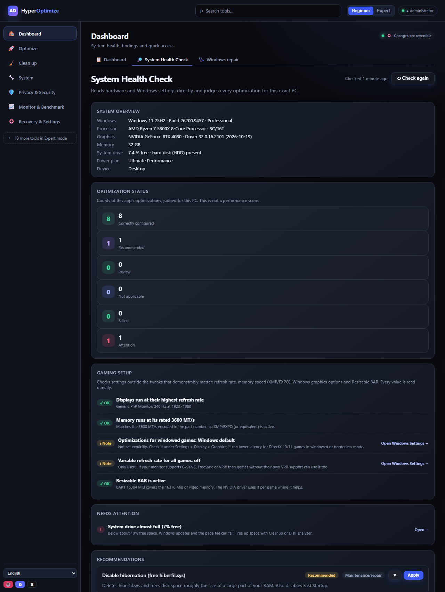
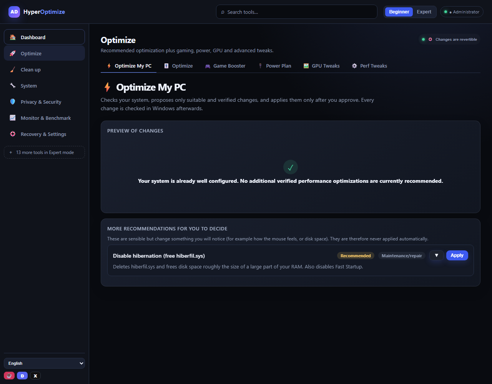
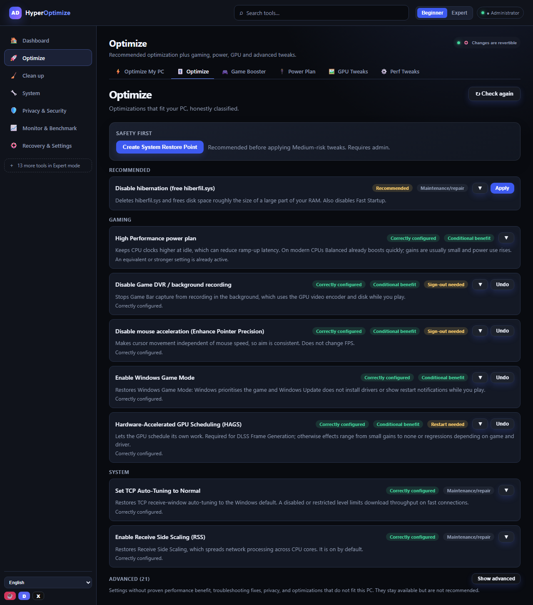

<div align="center">



# ⚡ AD HyperOptimize

**A Windows gaming optimizer that tells you what actually helps on *your* PC, and what doesn't.**

It reads your hardware and Windows settings and recommends only changes that apply to your system. Before reporting a change as done, it confirms it in Windows. Every change can be undone to its exact previous value.

[](https://github.com/zCrxticxl/ad-hyperoptimize/stargazers)
[](#license)
[](https://github.com/zCrxticxl/ad-hyperoptimize/commits)
[](https://discord.gg/vFaKsVuxKP)




<sub>The System Health Check on a real PC: detected hardware, what is already correct, and what is worth changing.</sub>

<a href="https://www.buymeacoffee.com/zCrxticxl"></a>

</div>

## Why this one is different

Most "optimizers" apply the same internet tweak list to every PC and report success when a command ran. AD HyperOptimize does the opposite:

| Typical optimizer | AD HyperOptimize |
|---|---|
| Same tweak list for every PC | Checks your CPU, GPU, RAM, storage, power plan and Windows version, then offers only what applies |
| "+30 % FPS" claims | **No invented numbers.** Each optimization says what it changes and when it can help. Nothing is labelled a proven FPS gain unless it was measured. |
| Keeps myths alive (Nagle, QoS 20 %, IRPStackSize, …) | Myths and settings that only restate Windows defaults are **retired**. If one is still active from earlier, *Reset all* restores your original values. |
| "Done!" after a command ran | Each change is read back from Windows. Each result is reported as *verified*, *needs restart*, *already optimized*, *skipped*, *failed* or *could not be verified*. |
| No way back | Previous values are captured before every change. Undo restores exactly those values, not a guessed default. |
| Phones home | **No telemetry.** Nothing is sent anywhere. The only network access is the signed self-updater. |

## What it does

### Check
- **System Health Check.** Reads the Windows build and support status, the CPU and its traits (hybrid P/E cores, dual-CCD X3D), the GPU and driver date, RAM, storage, free space, power plan, page file and Defender state. Each optimization gets a verdict for this exact PC: correctly configured, recommended, optional, not applicable, or needs review.
- **Gaming setup checks.** These cover things that demonstrably matter and that no registry tweak can fix:
  - monitor running below its maximum refresh rate
  - RAM not running at its rated XMP/EXPO speed
  - *Optimizations for windowed games* and VRR settings
  - Resizable BAR on NVIDIA
- **Findings.** Covers disk space, SMART, drivers, startup load, temperatures and event logs. The findings score is defined as "100 minus weighted findings". It is not a performance score.

### Optimize
- **Optimize My PC.** You get a preview of the proposed changes and approve them. Each change is applied, then confirmed in Windows. Only low-risk changes are included, such as turning Game Mode back on, stopping background game capture, or restoring TCP auto-tuning or RSS if they were disabled. If nothing is needed, it says so.
- **Optimize.** Shows only the optimizations that fit your PC, grouped as *Recommended*, *Gaming* and *System*. Everything else stays available under *Advanced* with its honest classification.
- **Power plans, GPU tweaks, Game Booster, Latency analysis** (DPC/ISR counters, WPR traces), **Boot options** and **Profiles**, all with exact undo.

<table>
<tr>
<td width="50%"></td>
<td width="50%"></td>
</tr>
</table>

### Measure
- **In-game FPS comparison.** Import frame-time captures from **PresentMon, CapFrameX or NVIDIA FrameView** before and after a change. The app compares average FPS, 1 % and 0.1 % lows, taking run-to-run variation into account. It does not capture frames itself, and it tells you when the difference is within noise or there are too few runs.
- **Benchmarks** for CPU, memory and disk, with history. **Live monitor** and **sensors** (temperatures, SMART).

### Clean up and control
- **Cleanup** (whitelisted temp/cache folders), **Uninstaller** with backed-up leftover removal, **Disk analyzer**, **Debloater**, **Registry cleaner** with real `.reg` backups, **Context menu cleaner**.
- **Startup**, **Services** (core Windows services are protected from being disabled), **Scheduled tasks**, **Processes**, **Drivers**, **Updates**.
- **Privacy Center** (telemetry, advertising ID, activity history, …) and **Security Center** (Defender, firewall, unsigned drivers, hosts file). Nothing changes without an explicit click. Turning off Defender always asks for confirmation.

**Navigation:** a sidebar with 8 sections, every tool as a tab, and a global search that also finds individual settings (e.g. "HAGS"). There are Beginner and Expert modes and 9 languages.

## Safety model

```
preview → your approval → capture previous values (+ .reg backup) → write-ahead journal → apply → read back from Windows
                                                                               └── failure? roll back ──┘
```

1. **Write-ahead journal.** Previous values are recorded before anything changes, and a failed apply rolls back automatically.
2. **Exact undo.** Registry values, service start types, power plans and boot settings are restored to what they were, never to an assumed default.
3. **Protected state.** The undo journal and backups are stored in an admin-only folder (`%ProgramData%\ADHyperOptimize`), so other programs cannot plant commands there for the next Undo.
4. **Restore points** are offered before larger changes.
5. **Runs elevated** because most system settings need administrator rights. The interface cannot open files or launch programs; links open only in the browser or Explorer.

## Get it

Download the latest installer (`.exe` or `.msi`) from [**Releases**](https://github.com/zCrxticxl/ad-hyperoptimize/releases).

Every release includes `SHA256SUMS.txt` for verifying the download. If an installer is not code-signed, Windows SmartScreen may warn on first start ("More info" → "Run anyway"). See [CODE_SIGNING.md](CODE_SIGNING.md).

### Update signature verification

The built-in updater verifies every package against a minisign key embedded in the app. The public key fingerprint is:

```
75A816CD47EDE457
```

If this fingerprint ever changes in a release, treat it as a supply-chain warning and verify through a second channel before updating.

## Build from source

<details>
<summary><b>Prerequisites and build steps</b></summary>

1. [Rust](https://rustup.rs) (MSVC toolchain: `rustup default stable-msvc`)
2. [Node.js 20+](https://nodejs.org)
3. Visual Studio Build Tools, "Desktop development with C++"
4. WebView2 runtime (preinstalled on Windows 10/11)

```powershell
git clone https://github.com/zCrxticxl/ad-hyperoptimize.git
cd ad-hyperoptimize
npm ci

npm run tauri dev     # development with hot reload
npm run tauri build   # NSIS .exe + .msi in src-tauri/target/release/bundle/
```

Quality gate (the same as CI):

```powershell
npm run build
cargo fmt --manifest-path src-tauri/Cargo.toml -- --check
cargo test --manifest-path src-tauri/Cargo.toml --locked
cargo clippy --manifest-path src-tauri/Cargo.toml --locked --all-targets -- -D warnings
```

</details>

<details>
<summary><b>Architecture</b></summary>

- `src/`: React + TypeScript frontend. `App.tsx` (sidebar shell and search), `api.ts` (typed Tauri commands), `pages/` (one file per tool).
- `src-tauri/src/`: Rust backend. The key modules:

  | Module | Role |
  |---|---|
  | `tweaks.rs` | Tweak catalog, live state detection, apply/undo |
  | `optregistry.rs` | Evidence class, applicability rules and retirement for every tweak |
  | `optimizer.rs` | System Health Check, Optimize My PC, verification, gaming setup checks |
  | `safety.rs`, `statestore.rs` | Journal, backups, restore points, protected state folder |
  | `ps.rs` | PowerShell bridge (strict quoting, timeouts) |
  | `frametime.rs` | Frame-time CSV import and before/after comparison |

**Adding an optimization:** add a `Tweak {}` entry in `tweaks.rs` and an entry in `optregistry.rs` with its evidence class, purpose and applicability rules. A test fails if either is missing.

Release process: [docs/RELEASING.md](docs/RELEASING.md). Audit and engine documentation: [docs/audit-2026-10/](docs/audit-2026-10/).

</details>

## License

AD HyperOptimize is **source-available under a non-commercial license**, which GitHub shows as license "other". Personal and other non-commercial use is allowed. Commercial use, redistribution in paid offerings, and enterprise deployment need a separate agreement; see [COMMERCIAL-LICENSING.md](COMMERCIAL-LICENSING.md) and [LICENSE-noncommercial](LICENSE-noncommercial).

Security issues: please report them privately as described in [SECURITY.md](SECURITY.md).

## Community & support

Questions, bug reports, suggestions: [**Discord**](https://discord.gg/vFaKsVuxKP) or [open an issue](https://github.com/zCrxticxl/ad-hyperoptimize/issues).

<div align="center">
<sub>Built with 🦀 + ⚡ by <a href="https://github.com/zCrxticxl">Adrian (zCrxticxl)</a>. Also see <a href="https://github.com/zCrxticxl/adhyper-linux">adhyper-linux</a> and <a href="https://github.com/zCrxticxl/adrice">adrice</a>.</sub>
</div>
